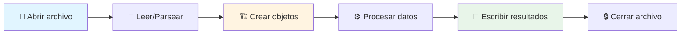
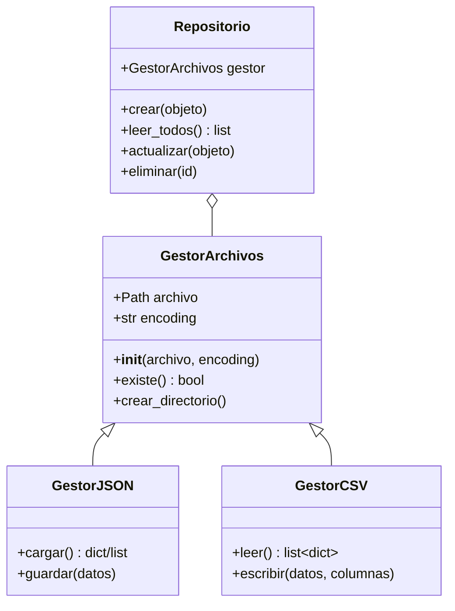

# 📁 Python: Manejo de Archivos + POO

> Guía visual, cheatsheet y ejercicios completos de manejo de archivos (txt, csv, json) en Python estándar + Programación Orientada a Objetos

---

## 📚 Contenido

- [📖 Introducción](#-introducción)
- [🔧 Modos de Apertura](#-modos-de-apertura)
- [📄 Archivos de Texto](#-archivos-de-texto)
- [🗂️ Archivos CSV](#️-archivos-csv)
- [🔤 Archivos JSON](#-archivos-json)
- [🛣️ Pathlib](#️-pathlib)
- [⚠️ Manejo de Excepciones](#️-manejo-de-excepciones)
- [🎯 Serialización de Objetos](#-serialización-de-objetos)
- [📋 Recursos](#-recursos)

---

## 📖 Introducción

Este repositorio cubre el manejo de archivos en Python **vanilla** (biblioteca estándar únicamente) como base para ejercicios de POO de nivel intermedio/avanzado. **Sin pandas, sin bibliotecas externas.**

### 🔄 Flujo General de Trabajo con Archivos



### 📊 Comparación de Formatos

| Formato | Uso Principal | Estructura | Legible | Tipado |
|---------|---------------|------------|---------|---------|
| **TXT** | Logs, texto plano | Lineal, libre | ✅ Sí | ❌ No |
| **CSV** | Tablas, datos estructurados | Filas/columnas | ✅ Sí | ⚠️ Básico |
| **JSON** | APIs, configs, datos anidados | Jerárquica | ✅ Sí | ✅ Parcial |

---

## 🔧 Modos de Apertura

### Tabla de Modos

| Modo | Descripción | Crea si no existe | Sobrescribe | Posición |
|------|-------------|-------------------|-------------|----------|
| `r` | Lectura | ❌ Error | - | Inicio |
| `w` | Escritura | ✅ Sí | ✅ Sí | Inicio |
| `a` | Anexar | ✅ Sí | ❌ No | Final |
| `x` | Creación exclusiva | ✅ Sí (error si existe) | - | Inicio |
| `r+` | Lectura + escritura | ❌ Error | ❌ No | Inicio |
| `w+` | Escritura + lectura | ✅ Sí | ✅ Sí | Inicio |
| `a+` | Anexar + lectura | ✅ Sí | ❌ No | Final |

### Modificadores

| Modificador | Descripción | Uso |
|-------------|-------------|-----|
| `b` | Modo binario | Imágenes, PDFs: `rb`, `wb` |
| `t` | Modo texto (default) | Texto: `rt`, `wt` |

### 🌐 Encodings Comunes

| Encoding | Uso | Caracteres |
|----------|-----|------------|
| `utf-8` | **Estándar universal** | Todos (español, emojis, etc.) |
| `latin-1` | Archivos antiguos/legacy | Español, acentos limitados |
| `ascii` | Solo inglés básico | A-Z, 0-9 |

```python
# ✅ Siempre especifica encoding para texto
with open('archivo.txt', 'r', encoding='utf-8') as f:
    contenido = f.read()
```

---

## 📄 Archivos de Texto

### 📖 Lectura

```python
from pathlib import Path

# Método 1: read() - todo el contenido
with open('datos.txt', 'r', encoding='utf-8') as f:
    contenido = f.read()
    print(contenido)

# Método 2: readlines() - lista de líneas (con \n)
with open('datos.txt', 'r', encoding='utf-8') as f:
    lineas = f.readlines()
    for linea in lineas:
        print(linea.strip())  # strip() elimina \n

# Método 3: iterar línea por línea (EFICIENTE para archivos grandes)
with open('datos.txt', 'r', encoding='utf-8') as f:
    for linea in f:
        print(linea.strip())

# Con pathlib
ruta = Path('datos.txt')
contenido = ruta.read_text(encoding='utf-8')
```

### ✍️ Escritura

```python
# Sobrescribir archivo
with open('salida.txt', 'w', encoding='utf-8') as f:
    f.write('Primera línea\n')
    f.write('Segunda línea\n')

# Escribir lista de líneas
lineas = ['Línea 1\n', 'Línea 2\n', 'Línea 3\n']
with open('salida.txt', 'w', encoding='utf-8') as f:
    f.writelines(lineas)

# Con pathlib
ruta = Path('salida.txt')
ruta.write_text('Contenido completo\n', encoding='utf-8')
```

### ➕ Anexar (append)

```python
# Agregar al final sin borrar contenido existente
with open('log.txt', 'a', encoding='utf-8') as f:
    f.write('Nueva entrada de log\n')
```

---

## 🗂️ Archivos CSV

### 📖 Lectura

```python
import csv

# Método 1: csv.reader (listas)
with open('datos.csv', 'r', encoding='utf-8', newline='') as f:
    lector = csv.reader(f)
    encabezado = next(lector)  # Primera fila
    for fila in lector:
        print(fila)  # ['valor1', 'valor2', ...]

# Método 2: csv.DictReader (diccionarios - RECOMENDADO)
with open('datos.csv', 'r', encoding='utf-8', newline='') as f:
    lector = csv.DictReader(f)
    for fila in lector:
        print(fila)  # {'columna1': 'valor1', 'columna2': 'valor2', ...}
        print(fila['nombre'])  # Acceso por nombre de columna

# Con delimitador personalizado
with open('datos.csv', 'r', encoding='utf-8', newline='') as f:
    lector = csv.DictReader(f, delimiter=';')
    for fila in lector:
        print(fila)
```

### ✍️ Escritura

```python
import csv

# Método 1: csv.writer (listas)
with open('salida.csv', 'w', encoding='utf-8', newline='') as f:
    escritor = csv.writer(f)
    escritor.writerow(['nombre', 'edad', 'nota'])  # Encabezado
    escritor.writerow(['Ana', '22', '9.5'])
    escritor.writerow(['Luis', '23', '8.7'])

# Método 2: csv.DictWriter (diccionarios - RECOMENDADO)
with open('salida.csv', 'w', encoding='utf-8', newline='') as f:
    columnas = ['nombre', 'edad', 'nota']
    escritor = csv.DictWriter(f, fieldnames=columnas)
    
    escritor.writeheader()  # Escribe encabezado
    escritor.writerow({'nombre': 'Ana', 'edad': 22, 'nota': 9.5})
    escritor.writerow({'nombre': 'Luis', 'edad': 23, 'nota': 8.7})

# Con delimitador personalizado
with open('salida.csv', 'w', encoding='utf-8', newline='') as f:
    escritor = csv.writer(f, delimiter=';')
    escritor.writerow(['col1', 'col2'])
```

⚠️ **Importante**: Usa `newline=''` al abrir CSVs para evitar líneas vacías extras en Windows.

---

## 🔤 Archivos JSON

### 📖 Lectura

```python
import json

# Desde archivo
with open('datos.json', 'r', encoding='utf-8') as f:
    datos = json.load(f)  # Retorna dict o list
    print(datos['clave'])

# Desde string
texto_json = '{"nombre": "Ana", "edad": 22}'
datos = json.loads(texto_json)
print(datos['nombre'])  # Ana
```

### ✍️ Escritura

```python
import json

datos = {
    'nombre': 'Ana García',
    'edad': 22,
    'materias': ['Cálculo', 'Programación', 'Física'],
    'notas': {'calc': 9.5, 'prog': 10.0}
}

# A archivo
with open('salida.json', 'w', encoding='utf-8') as f:
    json.dump(datos, f, indent=4, ensure_ascii=False)
    # indent=4: formato legible con indentación
    # ensure_ascii=False: permite acentos y ñ

# A string
texto_json = json.dumps(datos, indent=2, ensure_ascii=False)
print(texto_json)
```

### 🏗️ Estructuras Anidadas

```python
import json

biblioteca = {
    'nombre': 'Biblioteca Central',
    'libros': [
        {
            'titulo': 'Cien Años de Soledad',
            'autor': 'Gabriel García Márquez',
            'prestamos': [
                {'usuario': 'Ana', 'fecha': '2024-01-15'},
                {'usuario': 'Luis', 'fecha': '2024-02-20'}
            ]
        },
        {
            'titulo': 'Don Quijote',
            'autor': 'Miguel de Cervantes',
            'prestamos': []
        }
    ]
}

# Acceso anidado
print(biblioteca['libros'][0]['prestamos'][0]['usuario'])  # Ana
```

---

## 🛣️ Pathlib

### ¿Por qué Pathlib?

- ✅ Multiplataforma (Windows, Linux, Mac)
- ✅ Orientado a objetos
- ✅ Más legible que `os.path`

```python
from pathlib import Path

# Crear rutas
ruta = Path('data/estudiantes.csv')
ruta_absoluta = Path.cwd() / 'data' / 'estudiantes.csv'

# Operaciones comunes
print(ruta.exists())        # ¿Existe?
print(ruta.is_file())       # ¿Es archivo?
print(ruta.is_dir())        # ¿Es directorio?
print(ruta.name)            # estudiantes.csv
print(ruta.stem)            # estudiantes (sin extensión)
print(ruta.suffix)          # .csv
print(ruta.parent)          # data/

# Crear directorios
Path('output').mkdir(exist_ok=True)
Path('output/reportes').mkdir(parents=True, exist_ok=True)

# Listar archivos
for archivo in Path('data').iterdir():
    print(archivo)

# Filtrar por extensión
for csv_file in Path('data').glob('*.csv'):
    print(csv_file)

# Leer/escribir
contenido = Path('archivo.txt').read_text(encoding='utf-8')
Path('salida.txt').write_text('Hola mundo\n', encoding='utf-8')
```

---

## ⚠️ Manejo de Excepciones

### Excepciones Comunes

```python
from pathlib import Path
import json
import csv

# FileNotFoundError
try:
    with open('archivo_inexistente.txt', 'r') as f:
        contenido = f.read()
except FileNotFoundError:
    print('❌ Error: El archivo no existe')

# JSONDecodeError
try:
    with open('datos.json', 'r') as f:
        datos = json.load(f)
except json.JSONDecodeError as e:
    print(f'❌ Error de JSON: {e}')

# ValueError (conversión de tipos)
try:
    edad = int('no_es_un_numero')
except ValueError as e:
    print(f'❌ Error de conversión: {e}')

# Manejo múltiple
try:
    ruta = Path('data/estudiantes.csv')
    with open(ruta, 'r', encoding='utf-8') as f:
        lector = csv.DictReader(f)
        for fila in lector:
            nota = float(fila['nota'])
except FileNotFoundError:
    print(f'❌ No se encontró: {ruta}')
except KeyError as e:
    print(f'❌ Columna faltante: {e}')
except ValueError as e:
    print(f'❌ Valor inválido: {e}')
```

---

## 🎯 Serialización de Objetos

### Patrón: Objeto ↔ Diccionario

```python
import json
from pathlib import Path

class Estudiante:
    def __init__(self, nombre, edad, carrera, notas):
        self.nombre = nombre
        self.edad = edad
        self.carrera = carrera
        self.notas = notas  # dict: {'materia': nota}
    
    def to_dict(self):
        """Convierte el objeto a diccionario para JSON"""
        return {
            'nombre': self.nombre,
            'edad': self.edad,
            'carrera': self.carrera,
            'notas': self.notas
        }
    
    @classmethod
    def from_dict(cls, datos):
        """Crea un objeto desde un diccionario"""
        return cls(
            nombre=datos['nombre'],
            edad=datos['edad'],
            carrera=datos['carrera'],
            notas=datos['notas']
        )
    
    @classmethod
    def from_csv_row(cls, fila):
        """Crea un objeto desde una fila CSV (dict)"""
        return cls(
            nombre=fila['nombre'],
            edad=int(fila['edad']),
            carrera=fila['carrera'],
            notas={}  # Notas se cargan por separado
        )
    
    def __str__(self):
        return f'{self.nombre} ({self.edad} años) - {self.carrera}'

# Guardar lista de objetos en JSON
estudiantes = [
    Estudiante('Ana', 22, 'Ingeniería', {'Cálculo': 9.5, 'Programación': 10}),
    Estudiante('Luis', 23, 'Sistemas', {'Cálculo': 8.7, 'Programación': 9.2})
]

with open('estudiantes.json', 'w', encoding='utf-8') as f:
    datos = [est.to_dict() for est in estudiantes]
    json.dump(datos, f, indent=4, ensure_ascii=False)

# Cargar desde JSON
with open('estudiantes.json', 'r', encoding='utf-8') as f:
    datos = json.load(f)
    estudiantes = [Estudiante.from_dict(d) for d in datos]
    for est in estudiantes:
        print(est)
```

### Diagrama de Clases: Gestión de Archivos



---

## 📋 Recursos

### 📚 Documentación

- **Cheatsheet**: [CHEATSHEET.md](CHEATSHEET.md) - Referencia rápida de una página
- **Ejercicios**: [ejercicios/](ejercicios/) - 10 ejercicios prácticos con soluciones

### 🗂️ Datos de Práctica

El directorio [data/](data/) contiene archivos realistas para los ejercicios:

- **CSV**: estudiantes, inventario, transacciones bancarias
- **JSON**: biblioteca, configuración, empleados
- **TXT**: logs de servidor, texto para análisis, ventas

### 🎯 Ejercicios (Progresión)

1. **Gestor de Notas** - CSV básico + clases
2. **Inventario de Productos** - JSON + persistencia
3. **Analizador de Logs** - TXT + estadísticas
4. **Sistema de Biblioteca** - JSON anidado + herencia
5. **Gestor Bancario** - CSV + excepciones personalizadas
6. **Conversor CSV↔JSON** - Ambos formatos + transformación
7. **Analizador de Frecuencias** - TXT + procesamiento
8. **Generador de Reportes** - Lectura múltiple + escritura
9. **Validador de Datos** - CSV + validación + reportes de errores
10. **Sistema de Empleados** - JSON complejo + CRUD completo

---

## 🚀 Uso

```bash
# Clonar el repositorio
git clone https://github.com/tu-usuario/python-archivos-poo.git
cd python-archivos-poo

# Ejecutar un ejercicio (desde la raíz del repositorio)
python3 ejercicios/01_gestor_notas/solucion.py

# O desde el directorio del ejercicio
cd ejercicios/01_gestor_notas
python3 solucion.py
```

---

## 📖 Context Managers

El bloque `with` garantiza que el archivo se cierre automáticamente:

```python
# ❌ Sin with (debes cerrar manualmente)
f = open('archivo.txt', 'r')
contenido = f.read()
f.close()  # ¡Fácil de olvidar!

# ✅ Con with (cierre automático)
with open('archivo.txt', 'r', encoding='utf-8') as f:
    contenido = f.read()
# Archivo cerrado automáticamente aquí
```

---

## 📝 Licencia

MIT - Libre para uso educativo

---

**¡Feliz codificación! 🐍✨**
